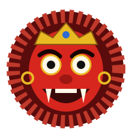
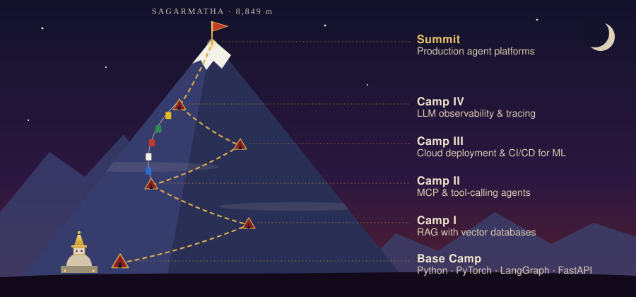

  

  

  
  
  
  
  

---

### ज्वजलपा! *(Jwajalapā, "hello" in Nepal Bhasa)*

I'm Swoham, a Computer Science student at **Kathmandu University** from **Banepa, Kavre**. I build AI systems that act, and the guardrails that keep them honest.

- 🧠 **AI Fellow @ Fusemachines**: building a governed multi-agent harness for clinical LLM agents (ongoing research)
- 🔬 **Research Intern @ KyraWorks & IoT R&D Lab, KU**: synthetic data and sim-to-real computer vision
- 📄 **Co-author** of [*Cognify*](https://ncci.ku.edu.np/uploads/archive/1770521400400-Cognify_KUSET-Aarya-Pathak.pdf), Kathmandu University Journal of Science, Engineering and Technology, 2024
- 🏆 National Winner, **Code for Impact 2026** · Best Innovation, **AiDA 2025** · Runner-Up, **KU Hackfest 2025**

---

## 🏯 The Nyatapol Principle

Bhaktapur's **Nyatapol** (built 1702 by King Bhupatindra Malla) is Nepal's tallest pagoda. Its five-tiered temple has never fallen, not even in the 1934 and 2015 earthquakes. Five pairs of guardians line its staircase, and legend says **each pair is ten times stronger than the one below**.

That is how I think about agent harnesses: layered guards, each one stricter than the last.

| Tier | Guardians | Layer in my agent harness |
|:---:|:---|:---|
| 5 | 🙏 Goddesses Baghini & Singhini | **Evaluation**: benchmarks, ablations, failure attribution |
| 4 | 🦅 Griffins | **Runtime caps**: round limits, timeouts, audit trails |
| 3 | 🦁 Lions | **Read-back verification**: confirm every write actually landed |
| 2 | 🐘 Elephants | **Deterministic policy**: rule checks with zero LLM calls |
| 1 | 🤼 Wrestlers Jaya & Phatta | **Structured I/O**: schemas, validation, typed state |

---

## 👹 Lakhey Mode: Fierce Face, Protective Purpose

The **Lakhey** dances through Kathmandu's streets during Indra Jatra. Majipa Lakhey looks like a demon but protects the city's children. Good guardrails work the same way: strict on the outside, there to keep the system safe.

**What I'm working on now**

- 🛡️ Governance layers for LLM agents on MedAgentBench clinical tasks
- 🕸️ Multi-agent ReAct orchestration with LangGraph StateGraphs
- ⚙️ Cost-aware serving: vLLM / Ollama locally, scale-to-zero GPUs on Modal, AWQ quantization
- 🧪 Ablation frameworks that show *which* guard fixed *which* failure

 

---

## 🛕 Heritage Builds

| Project | What it does | Stack |
|:---|:---|:---|
| **Clinical Agent Governance Harness**  Fusemachines · research in progress | Three-layer harness (control, agency, runtime) for clinical LLM agents, evaluated with ablations | LangGraph · vLLM · Ollama · Modal · Docker |
| **Synthetic Retail Data Pipeline**  KyraWorks & IoT R&D Lab | 250 procedurally rendered scenes, 2,788 auto-labeled objects, **62.63% sim-to-real transfer** with zero manual labels | BlenderProc · PyTorch |
| **vAnI** <!-- TODO: add repo link --> | Speech impairment detection with fine-tuned Wav2Vec2, **91.7% val. accuracy**, served by a FastAPI inference API | PyTorch · Hugging Face · FastAPI |
| **[Cognify](https://ncci.ku.edu.np/uploads/archive/1770521400400-Cognify_KUSET-Aarya-Pathak.pdf)**  peer-reviewed | NLP mental-health platform; multi-task BERT-CNN, **0.99 macro-F1** on depression/anxiety/ADHD screening | BERT · PyTorch |
| **cARd AI: Synaptic** <!-- TODO: add repo link --> | AR learning cards for autistic children with adaptive quizzes and LLM progress feedback | Unity · Vuforia · React Native · Supabase |

---

## 🏔️ Climbing Sagarmatha: What I'm Learning

  

---

## 🧰 Toolkit

**AI & LLM**

  
  
  
  
  
  
  
  
  

**Languages, Backend & Apps**

  

---

## 📊 Footprints

  
  

  

---

  Built in Banepa, in the shadow of the Himalaya · <i>"Each guardian ten times stronger than the last."</i>

